# Rapport final – Projet fil rouge CI/CD SouverainRecrut

| | |
|---|---|
| **Auteurs** | Evan Jeuland / Nathaël Martinelle |
| **Formation** | Mastère Expert en développement et déploiement de solutions numériques sécurisées – M2, Sup de Vinci Rennes |
| **Module** | CI/CD – RNCP 40166, blocs 4 et 5 |
| **Périmètre** | API Backend SouverainRecrut (Node.js 22, Express, TypeScript, Prisma) et base PostgreSQL |
| **Dépôts** | [GitHub `souverainrecrut`](https://github.com/EAnathos/souverainrecrut) (code, intégration continue) · [GitLab `souverainrecrut-deploiement`](https://gitlab.com/eanathos1/souverainrecrut-deploiement) (provisionnement, déploiement) |

---

## 1. Objectif et résultat

L'objectif était de construire une chaîne de livraison complète et reproductible : le code Backend est testé et analysé, une image Docker est construite, scannée et publiée sur Docker Hub, puis récupérée par un pipeline GitLab CI/CD pour être déployée sur un serveur Ubuntu préparé avec Terraform et Ansible.

**Résultat :** la chaîne fonctionne de bout en bout. Une modification poussée sur `Dev` est testée, analysée, construite, scannée et publiée par Jenkins ; elle est ensuite déployée en production après approbation manuelle, vérifiée automatiquement, et peut être annulée par un rollback testé.

| Indicateur | Valeur |
|---|---|
| Tests automatisés | 64 tests, 8 fichiers, 0 échec |
| Couverture | 99,4 % des lignes (seuil bloquant : 80 %) |
| Quality Gate SonarCloud | PASSED – 0 bug, 0 vulnérabilité, 0 code smell, 0 % de duplication |
| Scan Trivy | 0 vulnérabilité HIGH ou CRITICAL corrigeable sur les deux images |
| Versions déployées | `1.0.0-fcc937f`, `1.1.0-dbc9278` |
| Rollback | testé : 1.1.0 → 1.0.0, données conservées |
| Secrets dans les dépôts | aucun |

### Livrables

| Livrable demandé (§6) | Emplacement |
|---|---|
| Jenkinsfile | [`Jenkinsfile`](../Jenkinsfile) (racine du dépôt GitHub) |
| Dockerfile | [`backend/Dockerfile`](../backend/Dockerfile) (cibles API et `migrator`) |
| Configuration SonarQube | [`backend/sonar-project.properties`](../backend/sonar-project.properties) |
| Configuration Jenkins | [`jenkins/`](../jenkins) (Configuration as Code) |
| Rapports de tests et de couverture | [`junit.xml`](junit.xml), [`couverture/`](couverture/index.html) |
| Résultats SonarQube et Trivy | [`captures/sonarcloud.png`](captures/sonarcloud.png), [`trivy-report.txt`](trivy-report.txt), [`captures/trivy.png`](captures/trivy.png) |
| Terraform, Ansible, `deployment/`, `.gitlab-ci.yml` | dépôt GitLab [`souverainrecrut-deploiement`](https://gitlab.com/eanathos1/souverainrecrut-deploiement) |
| `architecture.md` | [architecture.md](architecture.md) |
| `procedure-deploiement.md` | [procedure-deploiement.md](procedure-deploiement.md) |
| `procedure-rollback.md` | [procedure-rollback.md](procedure-rollback.md) |
| Captures d'écran | [`captures/`](captures) |

Le projet est réparti sur deux dépôts, conformément à l'architecture cible du cahier des charges : le code et l'intégration continue sur GitHub, le provisionnement et le déploiement sur GitLab. Les procédures sont présentes dans les deux.

Ce rapport présente d'abord une synthèse (objectif, livrables et architecture, parties 1 et 2), puis le détail de la mise en œuvre dans l'ordre du cahier des charges (parties 3 à 5), les incidents rencontrés (partie 6) et enfin le bilan (parties 7 à 11).

## 2. Architecture mise en œuvre

```
GitHub (Dev) ─► Jenkins ─► tests ─► SonarCloud ─► build ─► Trivy ─► Docker Hub
                                                                       │ images API + migrations, même tag
VMware (VM Ubuntu) ◄─ Terraform ◄─ Ansible                             │
        │                                                              ▼
        └── GitLab Runner ◄── GitLab CI : validate ─► deploy (approbation) ─► verify ─► rollback
                 │
                 └─► Docker Compose : PostgreSQL ─► migrations Prisma ─► API
```

| Outil | Rôle dans la chaîne |
|---|---|
| Git, GitHub | Versionnement du code, branche de travail `Dev` |
| Jenkins | Orchestration de l'intégration continue ; configuré par code (JCasC), reproductible en une commande |
| Vitest, supertest | Tests unitaires et d'intégration de l'API, couverture |
| SonarCloud | Qualité du code, Quality Gate bloquant |
| Docker | Image de l'API et image de migrations, multi-étapes, non root |
| Trivy | Scan de vulnérabilités, seuil bloquant avant publication |
| Docker Hub | Registre des images versionnées |
| VMware Workstation | Hébergement de la VM de production |
| Terraform | Clé de déploiement, inventaire Ansible, contrôle d'accès SSH |
| Ansible | Configuration du serveur : disque, DNS, Docker, utilisateur de déploiement, pare-feu, runner |
| GitLab CI/CD | Pipeline de déploiement avec approbation, vérification et rollback |
| Docker Compose | Orchestration de PostgreSQL, des migrations et de l'API sur le serveur |

Le détail des composants, des flux réseau et des mesures de sécurité est dans [architecture.md](architecture.md).

---

## 3. Intégration continue avec Jenkins

### 3.1 Préparation du dépôt

- Fork : `github.com/EAnathos/souverainrecrut`, branche de travail `Dev`.
- Stratégie de branches : développement sur `Dev`, intégration dans `main` par Pull Request.
- Vérification locale : `npm ci` puis `npx prisma generate` dans `backend/`.

### 3.2 Tests Backend

**Choix : Vitest + supertest.**
- Vitest : support natif de TypeScript (pas de ts-jest), rapide, couverture v8 intégrée.
- supertest : tests HTTP sur l'application Express sans démarrer de serveur.
- Prisma est mocké (`vitest-mock-extended`) : les tests ne nécessitent pas de base PostgreSQL, ils sont donc rapides et reproductibles dans la pipeline.

**Couverture fonctionnelle (64 tests, 8 fichiers dans `backend/tests/`) :**

| Domaine | Cas testés |
|---|---|
| Authentification | login valide (JWT, mot de passe absent de la réponse), email inconnu, mauvais mot de passe, `/auth/me` |
| Contrôle des accès | sans token, schéma non Bearer, token falsifié, token expiré, `RECRUITER` refusé sur les routes `ADMIN` (403) |
| Candidats, offres, candidatures, utilisateurs | CRUD, pagination, 404, doublon d'email (409), validation Zod (400), hachage bcrypt du mot de passe |
| Système | `/health`, `/ready` (base disponible / indisponible → 503), `/info`, dashboard, 404, erreur 500 sans fuite d'information |

**Commandes et rapports :**

```bash
npm test                 # exécution des tests
npm run test:coverage    # tests + couverture
```

| Rapport | Chemin | Utilisé par |
|---|---|---|
| Couverture LCOV | `backend/coverage/lcov.info` | SonarQube |
| Couverture HTML | `backend/coverage/index.html` | lecture humaine |
| Résultats JUnit | `backend/reports/junit.xml` | Jenkins |

**Rapport de couverture joint :** [`couverture/index.html`](couverture/index.html) (rapport HTML détaillé par fichier) et [`couverture/lcov.info`](couverture/lcov.info) (format lu par SonarQube). Résumé : 99,4 % des instructions et des lignes (332/334), 94,2 % des branches, 100 % des fonctions.

**Résultat :** 64/64 tests OK, couverture 99,4 % des lignes. Un seuil de 80 % est imposé dans `vitest.config.ts` : en dessous, la commande échoue et bloque la pipeline.

**Rapport JUnit :** [`junit.xml`](junit.xml) – 64 tests, 0 échec, 0 erreur, exécutés en 0,79 s. C'est ce fichier que Jenkins lit pour afficher le détail des tests de chaque build.

| Fichier de tests | Tests | Échecs |
|---|---|---|
| `access-control.test.ts` | 11 | 0 |
| `candidates.test.ts` | 9 | 0 |
| `system.test.ts` | 9 | 0 |
| `applications.test.ts` | 8 | 0 |
| `jobs.test.ts` | 8 | 0 |
| `users.test.ts` | 8 | 0 |
| `unit.test.ts` | 6 | 0 |
| `auth.test.ts` | 5 | 0 |
| **Total** | **64** | **0** |

### 3.3 Analyse de la qualité avec SonarQube

**Outil :** SonarQube Cloud (organisation `eanathos`, projet `EAnathos_souverainrecrut`).

**Configuration :** `backend/sonar-project.properties` (sources `src`, tests `tests`, rapport LCOV, exclusion de `server.ts` et de la documentation Swagger). Le token n'est jamais versionné : il est fourni par la variable `SONAR_TOKEN`.

```bash
cd backend
npm run test:coverage
SONAR_TOKEN=*** npx @sonar/scan
```

**Problèmes relevés à la première analyse et corrections :**

| Type | Règle | Problème | Correction |
|---|---|---|---|
| Vulnérabilité | typescript:S5689 | L'en-tête `X-Powered-By` révèle la technologie (Express) | `app.disable("x-powered-by")` + test associé |
| Code smell (×2) | typescript:S7773 | `parseInt` global | `Number.parseInt` |

**Quality Gate « Sonar way » (code neuf) :**

| Condition | Seuil | Résultat |
|---|---|---|
| Couverture | ≥ 80 % | 100 % |
| Duplications | ≤ 3 % | 0 % |
| Notes fiabilité / sécurité / maintenabilité | A | A / A / A |
| Security hotspots revus | 100 % | 100 % |

**Bilan global :** 0 bug, 0 vulnérabilité, 0 code smell, 0 hotspot, 0 % de duplication, 98,6 % de couverture. Statut du Quality Gate : **PASSED**.

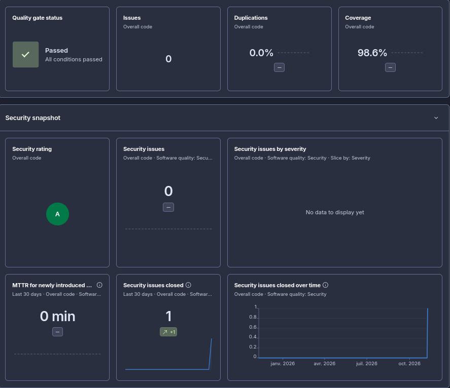

*Tableau de bord SonarCloud du projet `EAnathos_souverainrecrut` : Quality Gate « Passed » (toutes les conditions respectées), 0 issue, 0 % de duplication et 98,6 % de couverture sur l'ensemble du code. Volet sécurité : note A, 0 problème de sécurité ouvert, et 1 problème corrigé sur les 30 derniers jours (l'en-tête `X-Powered-By`). La couverture SonarCloud (98,6 %) diffère légèrement de celle de Vitest (99,4 %) car les deux outils ne comptent pas exactement les mêmes lignes.*

### 3.4 Mise en place de Jenkins

**Choix : Jenkins conteneurisé, configuré « as code » (plugin Configuration as Code, JCasC).**
- Toute la configuration (compte admin, outils, serveur SonarCloud, credentials, job) est décrite dans des fichiers versionnés : Jenkins est reproductible avec une seule commande, sans clic dans l'interface.
- Une première installation configurée à la main a montré la limite de cette approche : après un changement de réglage de sécurité, le compte admin était perdu. Avec JCasC, la configuration est réappliquée à chaque démarrage.

**Fichiers (`jenkins/`) :**

| Fichier | Rôle |
|---|---|
| `Dockerfile` | Image `jenkins/jenkins:lts-jdk21` + CLI Docker + plugins préinstallés |
| `plugins.txt` | Liste des plugins |
| `casc/jenkins.yaml` | Configuration JCasC : sécurité, Node 22, SonarCloud, credentials, job pipeline |
| `docker-compose.yml` | Lancement du conteneur, montage du socket Docker et de la configuration |
| `.env.example` | Modèle des variables secrètes (le vrai `.env` n'est pas versionné) |

```bash
cd jenkins
cp .env.example .env      # puis renseigner les valeurs
docker compose up -d --build
# interface : http://localhost:8080
```

**Plugins :**

| Besoin | Plugins |
|---|---|
| Pipeline et Git | `workflow-aggregator`, `pipeline-stage-view`, `git` |
| Configuration as code | `configuration-as-code`, `job-dsl` |
| Intégration SonarQube | `sonar` |
| Outillage et rapports | `nodejs`, `junit`, `htmlpublisher`, `credentials-binding`, `ws-cleanup`, `timestamper` |

**Accès au dépôt GitHub :** le job `souverainrecrut-backend` lit le `Jenkinsfile` de la branche `Dev` de `https://github.com/EAnathos/souverainrecrut.git`. Le dépôt étant public, aucun credential GitHub n'est nécessaire.

**Credentials (aucun secret dans le dépôt) :**

| ID Jenkins | Type | Usage | Source de la valeur |
|---|---|---|---|
| `sonar-token` | Secret text | Analyse SonarCloud | `SONAR_TOKEN` dans `jenkins/.env` |
| `dockerhub` | Username / password | Publication de l'image | `DOCKERHUB_USERNAME` et `DOCKERHUB_TOKEN` (token d'accès, pas le mot de passe du compte) |
| compte `admin` | Utilisateur Jenkins | Connexion à l'interface | `JENKINS_ADMIN_ID` / `JENKINS_ADMIN_PASSWORD` |

`jenkins/.env` est exclu par le `.gitignore` (`**/.env`). Les valeurs sont injectées dans JCasC sous forme de variables (`${SONAR_TOKEN}`) et masquées dans les logs de build.

**Accès à Docker :** le socket Docker de l'hôte est monté dans le conteneur (`/var/run/docker.sock`) et l'image embarque uniquement le CLI Docker. Jenkins pilote donc le démon de l'hôte pour construire, scanner et pousser l'image. Le conteneur tourne en `root` pour accéder au socket : acceptable pour un Jenkins local de développement, à remplacer par un agent dédié dans un environnement partagé.

**Sécurité de l'instance :** base d'utilisateurs Jenkins, inscription désactivée, accès anonyme refusé (403), assistant d'installation désactivé.

### 3.5 Automatisation de la chaîne CI

**Pipeline déclaratif :** `Jenkinsfile` à la racine du dépôt. Chaque étape bloque la suivante en cas d'échec : l'image n'est publiée que si tous les contrôles sont verts.

| # | Stage | Commande | Critère bloquant |
|---|---|---|---|
| 1 | Checkout | `checkout scm` (branche `Dev`) | dépôt inaccessible |
| 2 | Install | `npm ci` puis `npx prisma generate` | dépendance ou client Prisma en erreur |
| 3 | Tests & couverture | `npm run test:coverage` | test en échec ou couverture < 80 % |
| 4 | Analyse SonarQube & Quality Gate | `npx @sonar/scan -Dsonar.qualitygate.wait=true` | Quality Gate en échec |
| 5 | Build TypeScript | `npm run build` | erreur de compilation |
| 6 | Build image Docker | `docker build -t souverainrecrut-backend:<version>-<commit>` | échec du build |
| 7 | Scan Trivy | rapport complet, puis `--severity HIGH,CRITICAL --exit-code 1 --ignore-unfixed` (voir 3.6) | vulnérabilité HIGH ou CRITICAL corrigeable |
| 8 | Publication Docker Hub | `docker login` / `docker tag` / `docker push` | uniquement sur `Dev` ou `main` |

**Rapports publiés dans Jenkins :** résultats JUnit (`backend/reports/junit.xml`), couverture HTML (`backend/coverage/index.html`), archive du build (`backend/dist/**`).

**Déclenchement :** polling SCM toutes les 2 minutes (`H/2 * * * *`) sur la branche `Dev`. Un webhook GitHub n'est pas utilisable ici car Jenkins tourne sur `localhost`, inaccessible depuis GitHub.

**Contrôle du Quality Gate :** le paramètre `sonar.qualitygate.wait=true` fait attendre au scanner le verdict de SonarCloud (délai maximal de 300 s) et le fait échouer si le Quality Gate est rouge. Cette méthode remplace l'étape `waitForQualityGate`, qui suppose un webhook SonarCloud vers Jenkins, impossible vers `localhost`.

**Scan Trivy et corrections :** Trivy s'exécute dans un conteneur et lit l'image via le socket Docker ; sa base de vulnérabilités est conservée dans un volume (`trivy-cache`). Le premier scan a relevé 27 vulnérabilités HIGH/CRITICAL, toutes dans des paquets npm (l'Alpine de base était sain) :

| Origine | Exemples | Correction |
|---|---|---|
| npm embarqué dans l'image Node | `pacote`, `sigstore`, `picomatch`, `ip-address` | npm, npx et le cache retirés de l'image finale (inutiles à l'exécution) |
| Dépendances de l'application | `proxy-addr` (CRITICAL), `body-parser`, `js-yaml`, `fast-uri`, `brace-expansion` | `npm audit fix` |
| Dépendance transitive de Prisma | `deepmerge-ts` 7.1.5 | `@prisma/client` aligné sur le CLI (6.19.3) et `overrides` vers `deepmerge-ts` ^8 |

L'image a aussi été durcie : passage de `node:20-alpine` à `node:22-alpine` (aligné sur `engines`), ajout d'un `.dockerignore` (`node_modules`, `coverage`, `tests` ne sont plus copiés), `npm ci --omit=dev`. Après corrections : **0 vulnérabilité HIGH/CRITICAL**, les 64 tests passent et l'API démarre (réponse HTTP 200).

**Publication :** l'image est poussée sur Docker Hub sous `<DOCKERHUB_USERNAME>/souverainrecrut-backend`. La connexion utilise le credential `dockerhub` et se termine par un `docker logout`. Les builds #5 et #6 utilisaient le numéro de build comme tag ; il a été remplacé en 3.6 par un tag version + commit.

**Résultat – build #5 (commit `0425e7f`) : SUCCESS en 10 min 28 s**

| Stage | Résultat | Durée |
|---|---|---|
| Checkout | ✅ | 1 s |
| Install | ✅ | 52 s |
| Tests & couverture | ✅ 8 fichiers de tests, 99,4 % des lignes | 8 s |
| Analyse SonarQube & Quality Gate | ✅ `QUALITY GATE STATUS: PASSED` | 4 min 04 s |
| Build TypeScript | ✅ | 8 s |
| Build image Docker | ✅ | 3 min 42 s |
| Scan Trivy | ✅ 0 HIGH, 0 CRITICAL | 17 s |
| Publication Docker Hub | ✅ tags `5` et `dev` (même digest) | 1 min 06 s |

**Problèmes rencontrés :**

| Problème | Cause | Solution |
|---|---|---|
| `Read-only file system` sur `backend@tmp` | Pipeline exécuté dans un dossier monté en lecture seule | Travail dans le workspace Jenkins (clone Git) |
| Build #4 en échec (`ECONNRESET`) | Coupure réseau pendant `npm ci` dans le build Docker | Relance ; erreur ponctuelle, sans lien avec la pipeline |
| Polling sans effet après passage sur GitHub | Jenkins interroge le dépôt du dernier build (ancien dépôt local) | Un build manuel, puis le polling utilise GitHub |

**Déclenchement automatique – build #6 (commit `9b7f459`) :** lancé par le polling sans intervention (cause « Started by an SCM change »), le commit apparaît dans les *Changes*. SUCCESS en 2 min 38 s : le cache Docker (couches réutilisées) et le cache Trivy réduisent fortement la durée.

**Captures :**

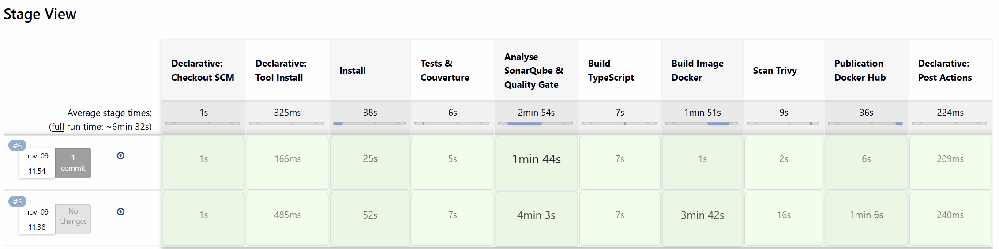

*Stage View du job `souverainrecrut-backend` : les stages sont verts pour les builds #5 (lancé manuellement, « No Changes » car premier build sur le dépôt GitHub) et #6 (déclenché par le polling, « 1 commit »). Sur le #6, le build de l'image passe de 3 min 42 s à 1 s grâce au cache Docker.*

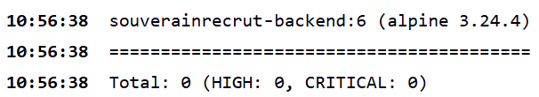

*Sortie du stage Scan Trivy du build #6 : l'image `souverainrecrut-backend:6` (base Alpine 3.24.4) ne présente aucune vulnérabilité HIGH ou CRITICAL. Une seule vulnérabilité de ce niveau aurait fait échouer le stage et bloqué la publication.*

### 3.6 Image Docker du Backend et publication sur Docker Hub

**Périmètre :** seule l'image de l'API Backend est construite et publiée. Aucune image de base de données n'est produite : PostgreSQL reste un service externe, et son adresse n'est jamais dans l'image (elle est fournie au lancement par `DATABASE_URL`).

#### Vérification et adaptation du Dockerfile

Le `backend/Dockerfile` fourni est multi-étapes (construction puis production). Audit et corrections :

| Constat | Risque | Correction |
|---|---|---|
| Base `node:20-alpine`, alors que `package.json` exige Node ≥ 22 | Version d'exécution différente de celle testée | `node:22-alpine` |
| Tag de base mobile (`node:22-alpine`) | Deux builds du même commit peuvent donner deux images différentes | Base **figée par digest** (`node:22-alpine@sha256:0e17…f8202`, Node 22.23.4, Alpine 3.24.4) |
| Pas de `.dockerignore` : `COPY . .` envoyait `node_modules`, `coverage`, `tests`, et un éventuel `.env` | Image lourde, fuite possible de secrets | `.dockerignore` : `node_modules`, `dist`, `coverage`, `reports`, `tests`, `.scannerwork`, `.env`, `*.log` |
| `npm ci --only=production` (option dépréciée) et npm présent dans l'image finale | npm inutile à l'exécution, 6 paquets vulnérables | `npm ci --omit=dev`, puis suppression de npm, npx et du cache |
| Application lancée en `root` | Une faille de l'API donnerait les droits root dans le conteneur | `USER node` (utilisateur non privilégié de l'image Node) |
| Le code écoute sur 4500 par défaut, l'image expose 4000 | Conteneur lancé sans `PORT` injoignable sur le port annoncé | `ENV PORT=4000` |
| Aucun contrôle de santé | Docker ne sait pas si l'API répond | `HEALTHCHECK` sur `/v1/health` |
| Aucune métadonnée | Impossible de savoir d'où vient une image | Labels OCI : `version`, `revision` (commit), `source`, `title` |

Les fichiers `package-lock.json` et `npm ci` garantissent des dépendances identiques à chaque build. Vérification du contenu de l'image : aucun fichier `.env`, seulement `dist/`, `prisma/` (schéma et migrations) et les dépendances de production.

#### Construction et tags

La version vient de `package.json` et l'identifiant de commit de Git ; ils sont aussi inscrits dans l'image (labels).

```bash
cd backend
VERSION=$(node -p "require('./package.json').version")      # 1.0.0
COMMIT=$(git rev-parse --short HEAD)                        # e6d91a9
docker build --build-arg VERSION=$VERSION --build-arg VCS_REF=$(git rev-parse HEAD) \
  -t VOTRE_COMPTE/souverainrecrut-backend:$VERSION-$COMMIT .
docker image ls
docker push VOTRE_COMPTE/souverainrecrut-backend:$VERSION-$COMMIT
```

| Tag | Exemple | Rôle | Branches |
|---|---|---|---|
| `<version>-<commit>` | `1.0.0-e6d91a9` | Immuable et traçable : désigne exactement un commit | `Dev` et `main` |
| `dev` | `dev` | Dernière image validée de `Dev` | `Dev` |
| `<version>` et `latest` | `1.0.0`, `latest` | Dernière version validée de production | `main` |

Dans Jenkins, ces commandes sont exécutées par les stages *Build Image Docker* et *Publication Docker Hub*.

#### Seuils de vulnérabilités Trivy

Trivy analyse l'image deux fois :
1. **Rapport complet**, toutes sévérités, non bloquant, archivé dans Jenkins (`trivy-report.txt`) ;
2. **Contrôle bloquant**, qui applique les seuils ci-dessous.

| Sévérité | Seuil accepté | Effet |
|---|---|---|
| CRITICAL | 0 (si un correctif existe) | Build en échec, pas de publication |
| HIGH | 0 (si un correctif existe) | Build en échec, pas de publication |
| MEDIUM, LOW | Tolérées | Listées dans le rapport, à traiter lors des mises à jour |
| Sans correctif disponible | Tolérées (`--ignore-unfixed`) | On ne peut pas les corriger ; elles restent visibles dans le rapport |

Justification : HIGH et CRITICAL sont les vulnérabilités exploitables à distance ou à fort impact ; bloquer sur celles qui ont un correctif force la mise à jour sans rendre la pipeline impossible à faire passer quand aucun correctif n'existe encore.

#### Publication conditionnée

Le stage *Publication Docker Hub* est le dernier de la pipeline : il n'est atteint que si les tests, le Quality Gate SonarCloud, le build et le contrôle Trivy ont réussi, et seulement sur `Dev` ou `main`. La connexion utilise un token d'accès Docker Hub (credential `dockerhub`), jamais le mot de passe du compte.

#### Résultat – build #9 (commit `e6d91a9`)

Déclenché automatiquement (« Started by an SCM change »), **SUCCESS en 6 min 17 s**.

| Contrôle | Résultat |
|---|---|
| Image construite | `souverainrecrut-backend:1.0.0-e6d91a9` |
| Quality Gate SonarCloud | `PASSED` |
| Trivy – contrôle bloquant | 0 HIGH, 0 CRITICAL |
| Trivy – rapport complet | 3 MEDIUM, tolérées : `zlib` (Alpine), `glob` et `minimatch` (dépendances de swagger-jsdoc) |
| Tags publiés | `1.0.0-e6d91a9` et `dev`, même digest `sha256:b434cc4e…1439c` |
| Test du conteneur (en local, même Dockerfile) | état `healthy`, utilisateur `node`, `/v1/health` → HTTP 200 sur le port 4000 |

**Rapport Trivy complet du build #9 :** [`trivy-report.txt`](trivy-report.txt) (artefact Jenkins, toutes sévérités).

**Image construite par Jenkins (`docker image ls`) :**

```
REPOSITORY                TAG             IMAGE ID       SIZE
souverainrecrut-backend   1.0.0-e6d91a9   b434cc4ef7d1   690MB
```

L'identifiant `b434cc4ef7d1` correspond au digest des tags `1.0.0-e6d91a9` et `dev` publiés sur Docker Hub : l'image publiée est bien celle qui a été scannée.

#### Évolution : image de migrations Prisma

Le CLI Prisma est une dépendance de développement et npm est retiré de l'image de l'API (3.6) : l'image ne peut donc pas appliquer les migrations au déploiement. Plutôt que de réintroduire ces outils dans l'image exposée, le `Dockerfile` contient une étape dédiée `migrator` :

| Image | Contenu | Commande |
|---|---|---|
| `souverainrecrut-backend:<tag>` | API seule (sans npm ni CLI Prisma) | `node dist/server.js` |
| `souverainrecrut-backend-migrate:<tag>` | dépendances de production + CLI Prisma (version figée par `package-lock.json`) + `prisma/` | `prisma migrate deploy` |

Jenkins construit les deux images à partir du **même commit**, les scanne avec les **mêmes seuils Trivy**, et les publie avec le **même tag** : la migration appliquée correspond toujours exactement au code déployé.

#### Résultat – build du commit `fcc937f`

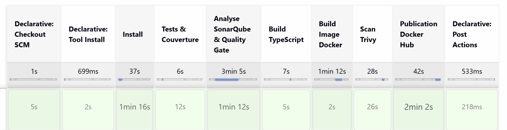

*Stage View : tous les stages sont verts, y compris le scan Trivy des deux images et leur publication. Tags publiés : `1.0.0-fcc937f` et `dev` pour `souverainrecrut-backend` et `souverainrecrut-backend-migrate`. C'est cette version qui est déployée en partie 5.*

---

## 4. Provisionnement

**Dépôt dédié :** [`gitlab.com/eanathos1/souverainrecrut-deploiement`](https://gitlab.com/eanathos1/souverainrecrut-deploiement). Il ne contient que l'infrastructure et le déploiement : le code reste sur GitHub et **l'image n'est jamais reconstruite côté GitLab**.

```
souverainrecrut-deploiement/
├── terraform/        clé de déploiement, inventaire Ansible, vérification SSH
├── ansible/          préparation du serveur (rôles docker_host et gitlab_runner)
├── deployment/       docker-compose.yml + .env.example
├── .gitlab-ci.yml    validate → deploy (manuel) → verify → rollback
└── documentation/    procédures de déploiement et de rollback
```

**Répartition des rôles entre les machines :**

| Machine | Rôle | Outils |
|---|---|---|
| Poste de développement (Windows) | Fabrique et publie l'image | Docker Desktop, Jenkins |
| Poste d'administration (WSL Ubuntu, sur le même PC) | Prépare le serveur, une seule fois | Terraform, Ansible |
| VM de production (VMware) | Exécute l'application | Docker Compose, GitLab Runner |
| GitLab.com | Pilote les déploiements | GitLab CI/CD |

Aucune action manuelle n'est faite sur le serveur de production : tout y est installé par Ansible et tout y est déployé par GitLab CI.

### 4.1 Préparation de l'environnement VMware

**Choix de départ :** un ESXi virtualisé dans VMware Workstation, pour pouvoir utiliser le provider Terraform vSphere. Ce choix a été abandonné (voir [incident n°1](#incident-1--virtualisation-imbriquée-impossible)) : la machine hôte ne permet pas la virtualisation imbriquée.

**Choix retenu :** une VM créée directement dans VMware Workstation.

| Ressource | Demandé | Réalisé |
|---|---|---|
| Système | Ubuntu Server 24.04 LTS | Ubuntu 22.04 LTS (image Desktop disponible) |
| Processeur | 2 vCPU | 2 vCPU |
| Mémoire | 4 Go | 4 Go |
| Stockage | 30 Go | 60 Go (agrandi, voir [incident n°5](#incident-5--disque-plein-pendant-le-déploiement)) |
| Réseau | NAT ou Bridged | NAT (`192.168.126.130`) |
| Administration | SSH | OpenSSH, authentification par clé depuis WSL |

Le playbook Ansible accepte toute version d'Ubuntu ≥ 22.04 : la différence de version est sans effet sur la chaîne. L'image Desktop embarque des paquets inutiles sur un serveur (interface graphique, snaps) ; en production réelle, une image Server minimale est préférable.

**Accès SSH :** une clé ED25519 est générée dans WSL et copiée sur la VM (`ssh-copy-id`). Toutes les opérations suivantes passent par cette clé, sans mot de passe SSH.

**Snapshot :** un snapshot a été pris avant toute configuration. Il a ensuite dû être supprimé, car VMware refuse d'agrandir le disque d'une VM qui possède des snapshots. Il n'a pas été recréé : la VM est reconstructible à l'identique avec Terraform et Ansible, ce qui joue le même rôle.

### 4.2 Provisionnement avec Terraform

**Contrainte :** le provider vSphere exige ESXi/vCenter. Sous VMware Workstation, la VM est créée manuellement ; Terraform gère les ressources réellement disponibles.

| Ressource | Rôle |
|---|---|
| `tls_private_key.deploy` | Paire de clés ED25519 dédiée au déploiement GitLab, distincte de la clé admin |
| `local_sensitive_file` / `local_file` | Écriture de la clé dans `.secrets/` (droits `0600`) |
| `local_file.ansible_inventory` | Inventaire Ansible généré depuis les variables (template `inventory.ini.tftpl`) |
| `null_resource.ssh_check` | Vérification de l'accès SSH à la VM (`remote-exec`) |

Fichiers : `providers.tf` (versions épinglées + `.terraform.lock.hcl`), `variables.tf` (IP validée), `main.tf`, `outputs.tf` (clé privée en `sensitive`).

```bash
cd terraform
cp terraform.tfvars.example terraform.tfvars   # server_ip, admin_user
terraform init && terraform validate && terraform plan && terraform apply
```

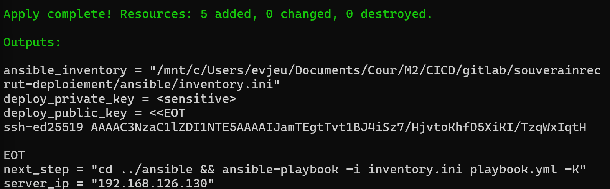

*`terraform apply` : 5 ressources créées. La clé privée reste masquée (`<sensitive>`) ; seule la clé publique est affichée. L'inventaire Ansible est généré et l'étape suivante est indiquée.*

**Sécurité :** l'état Terraform contient la clé privée : `*.tfstate`, `terraform.tfvars` et `.secrets/` sont exclus du dépôt. La clé privée n'en sort que vers la variable GitLab `SSH_PRIVATE_KEY`.

### 4.3 Configuration du serveur avec Ansible

**Structure :** `playbook.yml` + deux rôles. Les valeurs par défaut des rôles ont la priorité la plus basse : l'inventaire généré par Terraform les surcharge.

**Rôle `docker_host` :**

| Étape | Tâches |
|---|---|
| Contrôle | Refus si la cible n'est pas Ubuntu ≥ 22.04 |
| Disque | Agrandissement du volume racine à tout le disque : LVM (`lvol`) ou partition simple (`growpart` + `resize2fs`) |
| DNS | Résolveurs publics (`1.1.1.1`, `8.8.8.8`) dans `systemd-resolved` |
| Système | `apt update` + `dist-upgrade`, dépendances, redémarrage si `/var/run/reboot-required` |
| Docker | Suppression des paquets non officiels, dépôt APT officiel Docker (clé GPG), Docker Engine + plugin Compose, rotation des logs (`10m × 3`), service activé et démarré |
| Déploiement | Utilisateur `deploy` (groupe `docker`, clé publique Terraform uniquement), répertoire `/opt/souverainrecrut` (`0750`, propriétaire `deploy`) |
| Pare-feu | UFW : entrant refusé par défaut, SSH et port de l'API (4000) autorisés |
| Vérification | Service Docker actif, versions Docker/Compose, `docker run hello-world` exécuté par `deploy` |

Les tâches *Disque* et *DNS* ont été ajoutées pendant la mise en œuvre, à la suite des incidents n°3 et n°5 : chaque correction a été automatisée plutôt qu'appliquée à la main.

**Rôle `gitlab_runner` :**

La VM est en NAT derrière le PC : GitLab.com ne peut pas l'atteindre, alors qu'un déploiement par SSH depuis un runner partagé l'exigerait. Le runner est donc **installé sur le serveur lui-même** ; il interroge GitLab en sortie (HTTPS), ce que le NAT autorise.

| Tâche | Détail |
|---|---|
| Installation | Dépôt APT officiel GitLab Runner |
| Enregistrement | `gitlab-runner register` avec le jeton `glrt-…`, uniquement s'il n'est pas déjà enregistré (idempotent), jeton masqué (`no_log`) |
| Exécuteur | `shell`, utilisateur `gitlab-runner`, **sans accès Docker** |
| Vérification | `gitlab-runner verify` |

Le runner n'est pas membre du groupe `docker` (ce qui équivaudrait à un accès root) : il déploie en SSH avec l'utilisateur `deploy`, seul autorisé à piloter Docker.

```bash
cd ansible
ansible-galaxy collection install -r requirements.yml
ansible-playbook -i inventory.ini playbook.yml -K -e gitlab_runner_token=glrt-XXXX
```

Le jeton n'est jamais écrit dans un fichier : il est passé en ligne de commande. Sans jeton, le rôle `gitlab_runner` est ignoré.

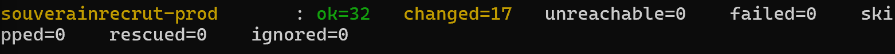

*Premier passage : 32 tâches exécutées, 17 modifications, 0 échec.*

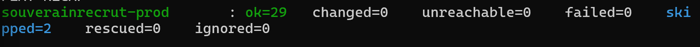

*Second passage : `changed=0`. Le playbook est idempotent : rejoué sur un serveur déjà configuré, il ne modifie rien. Les 2 tâches ignorées sont le redémarrage (inutile) et l'enregistrement du runner (déjà fait).*

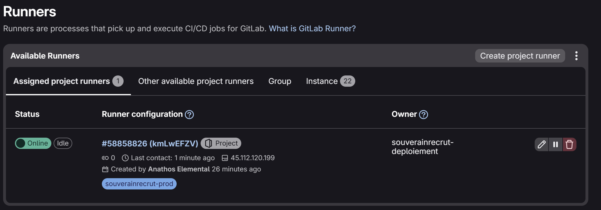

*Le runner installé par Ansible apparaît en ligne dans le projet GitLab, avec le tag `souverainrecrut-prod` utilisé par les jobs. L'adresse affichée est l'adresse publique de sortie du réseau, pas celle de la VM.*

**Validation :** le rôle `docker_host` initial passait `ansible-lint` (profil `production`) sans erreur ni avertissement. Le playbook complet, avec le rôle `gitlab_runner` et les tâches disque et DNS ajoutées ensuite, a été validé par son exécution réelle : `failed=0` au premier passage, `changed=0` au second.

### 4.4 Préparation du projet GitLab

**Variables CI/CD** (*Settings > CI/CD > Variables*) :

| Variable | Contenu | Type | Visibilité | Protégée |
|---|---|---|---|---|
| `DOCKERHUB_USER` | compte Docker Hub | Variable | Visible | non |
| `DOCKERHUB_TOKEN` | token Docker Hub en **lecture seule** | Variable | Masked and hidden | oui |
| `SSH_HOST` | `127.0.0.1` (le runner est sur le serveur) | Variable | Visible | non |
| `SSH_USER` | `deploy` | Variable | Visible | non |
| `SSH_PRIVATE_KEY` | clé de déploiement Terraform, encodée en base64 | File | Visible | oui |
| `POSTGRES_PASSWORD` | `openssl rand -hex 32` | Variable | Masked and hidden | oui |
| `JWT_SECRET` | `openssl rand -hex 32` | Variable | Masked and hidden | oui |
| `IMAGE_TAG` | tag à déployer, ex. `1.0.0-fcc937f` | Variable | Visible | non |

- **Masked and hidden** : valeur remplacée par `[MASKED]` dans les logs et illisible dans l'interface après création.
- **Protégée** : transmise uniquement aux pipelines des branches protégées (`main`).
- Le token Docker Hub de déploiement est **distinct** de celui de Jenkins et limité à la lecture : le serveur peut tirer les images, pas en publier.
- La clé SSH est stockée en base64 sur une ligne (voir [incident n°6](#incident-6--clé-ssh-abîmée-par-le-copier-coller)).

---

## 5. Déploiement applicatif et validation

### 5.1 Récupération de l'image Docker Hub

Le serveur ne reçoit jamais le code source : il tire les images publiées par Jenkins.

```bash
echo "$DOCKERHUB_TOKEN" | docker login -u "$DOCKERHUB_USER" --password-stdin
docker compose pull
docker logout
```

Le token passe par l'entrée standard (`--password-stdin`), jamais en argument (il serait visible dans la liste des processus), et la session est fermée juste après le `pull`.

### 5.2 Déploiement avec Docker Compose

**Fichier :** `deployment/docker-compose.yml`, modèle de variables : `deployment/.env.example`.

| Service | Image | Rôle | Santé | Redémarrage |
|---|---|---|---|---|
| `db` | `postgres:17-alpine` | Base de données | `pg_isready` | `unless-stopped` |
| `migrate` | `<compte>/souverainrecrut-backend-migrate:<tag>` | `prisma migrate deploy`, puis s'arrête | code de sortie | `no` |
| `api` | `<compte>/souverainrecrut-backend:<tag>` | API REST | `GET /v1/health` | `unless-stopped` |

**Ordre de démarrage garanti :** `db` *healthy* → `migrate` terminé avec succès (`service_completed_successfully`) → `api`. Si une migration échoue, l'API ne démarre pas sur un schéma incohérent.

| Exigence | Réalisation |
|---|---|
| Image versionnée | Tag `<version>-<commit>` fourni par `IMAGE_TAG`, jamais `latest` |
| Variables API et Prisma | `DATABASE_URL`, `JWT_SECRET`, `PORT`, `NODE_ENV` ; valeurs obligatoires contrôlées (`${VAR:?message}`) |
| Volume persistant | `souverainrecrut_pgdata` monté sur `/var/lib/postgresql/data` |
| Réseau | Réseau dédié `souverainrecrut_backend` ; **la base n'expose aucun port**, seule l'API publie le port 4000 |
| Redémarrage et santé | `restart: unless-stopped` et `healthcheck` sur `db` et `api` |
| Migrations maîtrisées | `migrate deploy` applique uniquement les migrations versionnées, sans jamais modifier ni réinitialiser la base |

**Stratégie de migration :** `prisma migrate deploy` est idempotent (une migration déjà appliquée n'est pas rejouée) et ne fait qu'avancer. Les migrations doivent donc suivre le principe *expand / contract* (voir 5.4).

### 5.3 Pipeline de déploiement GitLab CI/CD

**Fichier :** `.gitlab-ci.yml`. Le pipeline ne se lance **qu'à la main** (*Run pipeline*) : un push ne doit jamais déployer implicitement en production, et il ne fournirait pas le tag à déployer.

| Job | Déclenchement | Actions |
|---|---|---|
| `validate` | automatique | Format du tag (`^[0-9]+\.[0-9]+\.[0-9]+-[0-9a-f]{7}$`), présence des deux images sur Docker Hub, accès SSH et version de Docker |
| `deploy_production` | **manuel (approbation)** | Génère `.env` (droits 600), mémorise la version en place dans `.previous_tag`, copie `docker-compose.yml` et `.env`, `pull`, `up -d`, puis supprime le `.env` du runner |
| `verify_production` | automatique | Attend l'état `healthy` de l'API (150 s max), vérifie le code de sortie des migrations, `/v1/health`, `/v1/ready`, image en place |
| `rollback_production` | manuel | Retour à la version de `.previous_tag` (voir 5.4) |

**Sécurité du pipeline :**
- `deploy_production` est en `when: manual` avec `allow_failure: false` : le pipeline reste bloqué tant que le déploiement n'est pas approuvé.
- `resource_group: production` empêche deux déploiements simultanés.
- La clé SSH est écrite dans un répertoire propre au job (`0700`), vérifiée (`ssh-keygen -y`) et supprimée en fin de job ; l'empreinte du serveur est contrôlée (`StrictHostKeyChecking=yes`).
- Aucun secret n'apparaît dans les logs : variables masquées, `.env` jamais affiché, token Docker Hub via `--password-stdin`.

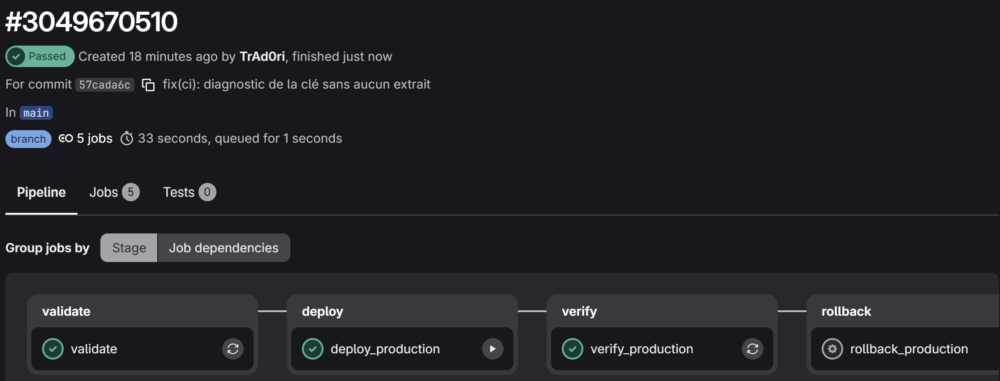

*Pipeline réussi : `validate` puis `deploy_production` (lancé après approbation, bouton ▶), puis `verify_production`. `rollback_production` reste en attente : c'est un job manuel, utilisé seulement en cas de besoin.*

**Réponse de l'API depuis le poste de travail :**

```bash
curl http://192.168.126.130:4000/v1/health
```
```json
{"success":true,"data":{"status":"UP","timestamp":"2026-11-10T13:13:40.526Z","uptime":64.62,"environment":"production"}}
```

### 5.4 Vérification et procédure de rollback

#### Endpoints principaux et accès à la base

La base étant vide et l'API sans route d'inscription, un compte administrateur est créé directement en base. Le mot de passe est haché avec le bcrypt de l'image de l'API, comme le fait l'application :

```bash
HASH=$(sudo docker exec souverainrecrut-api-1 node -e "console.log(require('bcrypt').hashSync('Admin1234!',10))")
sudo docker exec souverainrecrut-db-1 psql -U souverainrecrut -d souverainrecrut -c \
  "INSERT INTO users (id,\"firstName\",\"lastName\",email,password,role,\"createdAt\",\"updatedAt\")
   VALUES ('admin1','Admin','Test','admin@test.fr','$HASH','ADMIN',now(),now());"
```

| Test | Requête | Résultat | Ce que ça prouve |
|---|---|---|---|
| Santé | `GET /v1/health` | `200`, `status: UP` | L'API répond |
| Disponibilité | `GET /v1/ready` | `200` | L'API joint PostgreSQL |
| Authentification | `POST /v1/auth/login` | `200`, jeton JWT, mot de passe absent de la réponse | Lecture en base, bcrypt, signature JWT avec `JWT_SECRET` |
| Contrôle d'accès | `GET /v1/jobs` sans jeton valide | `401 Token invalide ou expiré` | Les routes protégées refusent l'accès |
| Route protégée | `GET /v1/jobs` avec le jeton | `200`, liste paginée (vide) | Jeton accepté, requête en base |

#### Persistance des données

```bash
sudo -u deploy bash -c "cd /opt/souverainrecrut && docker compose restart && sleep 20 && docker compose ps"
```

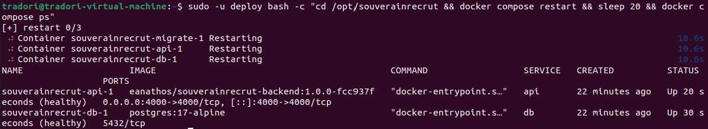

*Après redémarrage, `api` et `db` sont `healthy` ; l'image en place est bien `1.0.0-fcc937f`. La base n'expose que le port interne `5432/tcp`, sans publication sur l'hôte. Le login de `admin@test.fr` fonctionne toujours : les données ont survécu au redémarrage grâce au volume `souverainrecrut_pgdata`.*

La commande passe par `sudo -u deploy` : le répertoire `/opt/souverainrecrut` (`0750`) n'est accessible qu'à l'utilisateur de déploiement, pas au compte d'administration.

#### Rollback

**Principe :** chaque image est immuable et identifiée par son tag. Revenir en arrière consiste à relancer l'API sur un tag antérieur déjà publié, **sans reconstruire**. À chaque déploiement, le serveur conserve `.previous_tag` (version remplacée) et `.current_tag` (version en place).

Le job `rollback_production` lit `.previous_tag`, met à jour `IMAGE_TAG` dans `.env`, tire l'image et recrée **uniquement le conteneur `api`** (`up -d --no-deps api`), puis rejoue toutes les vérifications. Deux alternatives sont documentées dans `documentation/procedure-rollback.md` : relancer le pipeline avec un tag précis, ou la procédure manuelle de secours sur le serveur.

**Scénario de test :**

| Étape | Action | Résultat |
|---|---|---|
| 1 | Version en place : `1.0.0-fcc937f` | `/v1/info` → `"version":"1.0.0"` |
| 2 | Commit `dbc9278` sur `Dev` : version 1.1.0 (`package.json` et `/v1/info`) | Jenkins publie `1.1.0-dbc9278` (64 tests OK) |
| 3 | Pipeline GitLab avec `IMAGE_TAG=1.1.0-dbc9278`, approbation | `/v1/info` → `"version":"1.1.0"`, `.previous_tag` = `1.0.0-fcc937f` |
| 4 | Job `rollback_production` | `/v1/info` → `"version":"1.0.0"` |
| 5 | Login `admin@test.fr` | Toujours valide : les données sont conservées |

**Avant la mise à jour (étape 1)** – la production sert la version 1.0.0 :

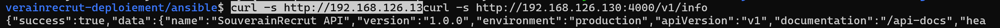

**Après le déploiement de `1.1.0-dbc9278` (étapes 2 et 3)** – Jenkins a publié la nouvelle image, GitLab l'a déployée après approbation, et l'API annonce la version 1.1.0 :

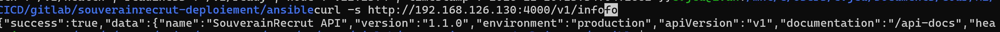

**Rollback (étape 4)** – le job manuel `rollback_production` du même pipeline s'est terminé avec succès, vérifications comprises ; `/v1/info` renvoie de nouveau `"version":"1.0.0"` :

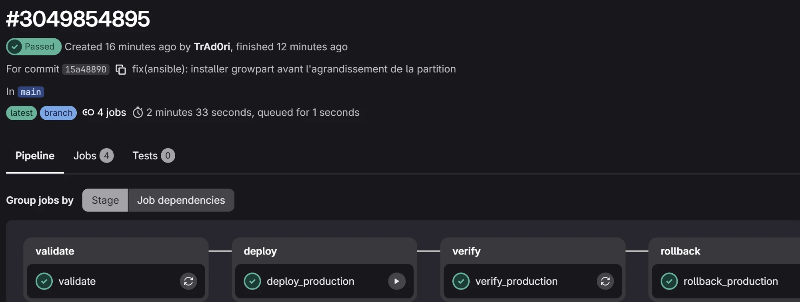

*Les quatre jobs du pipeline sont verts : déploiement de la 1.1.0, vérification, puis retour à la 1.0.0 en 2 min 33 s au total, sans reconstruire d'image.*

#### Limite du rollback : la base de données

Le rollback applicatif **ne défait pas les migrations** : `prisma migrate deploy` ne sait qu'avancer, et le job de rollback ne relance volontairement pas le service `migrate`. L'ancienne version de l'API tourne donc sur le schéma le plus récent. Pour que ce soit sans risque, les migrations suivent le principe *expand / contract* :

- une migration **ajoute** (table, colonne nullable ou avec valeur par défaut) ; elle ne supprime ni ne renomme dans la même version que le code qui en dépend ;
- une colonne n'est supprimée qu'**une version après** que le code a cessé de l'utiliser ;
- avant une migration destructive, la base est sauvegardée (`pg_dump`, commande dans `procedure-rollback.md`).

Le scénario testé (1.0.0 ↔ 1.1.0) ne contient aucune migration : le rollback est donc sans effet sur le schéma.

---

## 6. Incidents rencontrés et résolution

Chaque incident a suivi la même démarche : observer le symptôme, lire les logs, isoler la cause, puis **automatiser la correction** lorsqu'elle concerne le serveur, pour que la reconstruction reste reproductible.

### Incident 1 – Virtualisation imbriquée impossible

| | |
|---|---|
| **Symptôme** | La VM Ubuntu hébergée dans ESXi (lui-même virtualisé dans VMware Workstation) refuse de démarrer : *« Cet hôte ne prend pas en charge la technologie AMD-V »*, *« VHV est désactivé »*. |
| **Diagnostic** | AMD-V est bien activé dans le BIOS (`VirtualizationFirmwareEnabled : True`), mais Windows 11 exécute son propre hyperviseur (`HypervisorPresent : True`) pour la *Virtualization-Based Security*. Workstation fonctionne alors au-dessus de Hyper-V, qui ne lui transmet pas la virtualisation imbriquée nécessaire à ESXi. |
| **Tentatives** | Désactivation de la Plateforme d'ordinateur virtuel, de l'intégrité de la mémoire, `bcdedit /set hypervisorlaunchtype off`, désactivation de VBS par le registre : l'hyperviseur reste actif (VBS imposé par le firmware sur cette machine). |
| **Résolution** | Abandon d'ESXi : VM Ubuntu directement dans Workstation (fonctionne au-dessus de Hyper-V), restauration de la configuration Windows d'origine. Conséquence : le provider Terraform vSphere n'est pas utilisable (4.2). |

### Incident 2 – Terraform ne peut pas installer ses providers depuis WSL

| | |
|---|---|
| **Symptôme** | `terraform init` : *« chmod … LICENSE.txt: operation not permitted »*. |
| **Cause** | Le projet est sur le disque Windows, monté dans WSL sous `/mnt/c` sans métadonnées Linux : les droits Unix ne peuvent pas y être modifiés. Terraform en a besoin pour ses providers et pour écrire la clé privée en `0600` ; Ansible ignore aussi un `ansible.cfg` situé dans un répertoire modifiable par tous. |
| **Résolution** | Activation des métadonnées dans `/etc/wsl.conf` (`[automount] options = "metadata,umask=22,fmask=11"`), puis `wsl --shutdown`. |

### Incident 3 – Runner « Online » mais jobs bloqués en *pending* (DNS et NAT)

| | |
|---|---|
| **Symptôme** | Le job `validate` reste en *pending*, alors que GitLab affiche le runner *Online*. |
| **Diagnostic 1** | Logs du runner (`journalctl -u gitlab-runner`) : *« lookup gitlab.com on 127.0.0.53:53: server misbehaving »*. La VM ne résout plus les noms de domaine. |
| **Diagnostic 2** | Pendant le playbook, `apt` reste bloqué. `ping 1.1.1.1` → *Destination Host Unreachable* : la VM ne joint même plus sa passerelle NAT. Le service « VMware NAT Service » apparaît pourtant démarré sur l'hôte. |
| **Cause** | Le service NAT de VMware se fige après une veille ou un changement de réseau de l'hôte ; son relais DNS est par ailleurs instable. |
| **Résolution** | Redémarrage des services `VMware NAT Service` et `VMnetDHCP` sur l'hôte (correction immédiate), puis ajout dans Ansible de résolveurs DNS publics (`systemd-resolved`) pour ne plus dépendre du relais DNS de VMware. |

### Incident 4 – Pipeline déclenché par un push

| | |
|---|---|
| **Symptôme** | Le premier push sur le dépôt GitLab crée un pipeline immédiatement en échec. |
| **Cause** | Le pipeline se déclenchait aussi sur les push vers `main`, alors qu'aucun runner, variable ou tag n'était encore configuré. |
| **Résolution** | Règle `workflow` limitée à `CI_PIPELINE_SOURCE == "web"` : le déploiement est toujours une décision explicite, jamais l'effet d'un push. |

### Incident 5 – Disque plein pendant le déploiement

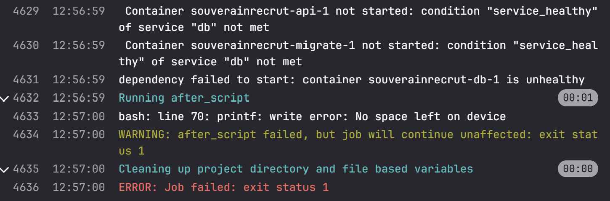

| | |
|---|---|
| **Symptôme** | `deploy_production` échoue : *« container souverainrecrut-db-1 is unhealthy »*, l'API et les migrations ne démarrent pas, puis *« No space left on device »*. |
| **Cause** | `df -h /` : 14 Go dont 91 % utilisés. La partition racine (`/dev/sda4`) n'occupait qu'une partie du disque virtuel ; les mises à jour système, Docker et les images ont saturé l'espace. PostgreSQL n'a pas pu initialiser sa base. |
| **Résolution** | Suppression du snapshot (obligatoire pour agrandir), disque virtuel porté à 60 Go dans VMware, puis `growpart /dev/sda 4` et `resize2fs /dev/sda4`. Ajout dans Ansible de l'agrandissement automatique de la racine, pour les deux cas rencontrés par l'installeur Ubuntu : LVM (`lvol` + `resizefs`) et partition simple (`growpart` + `resize2fs`). |

### Incident 6 – Clé SSH abîmée par le copier-coller

| | |
|---|---|
| **Symptôme** | `validate` : *« Load key …: error in libcrypto »* puis *« Permission denied (publickey) »*. |
| **Cause** | La clé privée, copiée depuis le terminal WSL vers l'interface GitLab, arrivait altérée (retours à la ligne, caractères de fin de ligne Windows, sélection incomplète). Le refus SSH n'était qu'une conséquence de la clé illisible. |
| **Résolution** | Le pipeline accepte désormais la clé encodée en **base64 sur une seule ligne** (`terraform output -raw deploy_private_key \| base64 -w0 \| clip.exe`), retire les `\r` et **valide la clé** (`ssh-keygen -y`) avant usage. En cas d'échec, il affiche un diagnostic (nombre de lignes, présence des en-têtes) sans jamais exposer son contenu. |
| **Piège associé** | Le bouton *Retry* d'un job rejoue l'**ancien commit** : il faut lancer un nouveau pipeline (*Run pipeline*) pour profiter d'un correctif. |

### Bilan

| Incident | Couche | Correction automatisée |
|---|---|---|
| 1. Virtualisation imbriquée | Poste hôte | — (changement d'architecture) |
| 2. `chmod` sur `/mnt/c` | Poste d'administration | — (configuration WSL, une fois) |
| 3. DNS / NAT VMware | Réseau | ✅ DNS publics par Ansible |
| 4. Pipeline sur push | CI/CD | ✅ règle `workflow` |
| 5. Disque plein | Serveur | ✅ agrandissement de la racine par Ansible |
| 6. Clé SSH abîmée | CI/CD | ✅ base64, normalisation et validation dans le pipeline |

---

## 7. Du commit à la production

Cheminement complet d'une modification, démontré avec la version 1.1.0 :

1. **Commit** `dbc9278` sur `Dev` : la version passe à 1.1.0.
2. **Jenkins** détecte le commit, installe les dépendances, exécute les 64 tests et contrôle la couverture.
3. **SonarCloud** analyse le code ; le scanner attend le verdict du Quality Gate et échoue s'il est rouge.
4. **Jenkins** compile, puis construit les deux images `1.1.0-dbc9278` (API et migrations).
5. **Trivy** scanne les deux images ; une vulnérabilité HIGH ou CRITICAL corrigeable bloquerait la suite.
6. **Docker Hub** reçoit les images, seulement si toutes les étapes précédentes sont vertes.
7. **GitLab** : l'opérateur renseigne `IMAGE_TAG=1.1.0-dbc9278` et lance le pipeline ; `validate` vérifie le tag et la présence des images.
8. **Approbation** : l'opérateur valide `deploy_production`.
9. **Serveur** : le runner se connecte en SSH avec l'utilisateur `deploy`, transmet `docker-compose.yml` et `.env`, tire les images ; Compose démarre la base, applique les migrations, puis l'API.
10. **Vérification** : `verify_production` contrôle l'état des conteneurs, le résultat des migrations, `/v1/health` et `/v1/ready`. `/v1/info` annonce 1.1.0.
11. **Rollback** : `rollback_production` remet l'API en `1.0.0-fcc937f` sans reconstruire d'image ; les données sont intactes.

À aucun moment le serveur ne reçoit le code source, et aucune commande n'est saisie à la main sur la production.

## 8. Conformité aux exigences (§7)

| Exigence | Attendu | Réalisation |
|---|---|---|
| Reproductibilité | Étapes décrites et rejouables | Jenkins configuré par code ; base Docker figée par digest et `npm ci` ; Terraform et Ansible idempotents (second passage `changed=0`) ; procédure de déploiement pas à pas |
| Qualité logicielle | Tests exécutés, couverture et SonarQube consultables | 64 tests dans chaque build, seuil de couverture bloquant, Quality Gate bloquant, rapports JUnit et HTML publiés dans Jenkins et joints au rendu |
| Sécurité | Secrets protégés, image analysée | Aucun secret versionné ; credentials Jenkins et variables GitLab masquées et protégées ; tokens Docker Hub distincts (écriture / lecture) ; image non root sans npm ; Trivy bloquant sur les deux images ; runner sans accès Docker ; base non exposée ; pare-feu |
| Traçabilité | Tag explicite relié au code | Tag `<version>-<commit>` commun aux deux images, labels OCI `version` et `revision` ; le job de vérification affiche l'image en place |
| Déploiement | Le serveur récupère l'image et l'API démarre avec PostgreSQL | Pull depuis Docker Hub, migrations puis API, `/v1/ready` vérifie l'accès à la base |
| Continuité | Rollback documenté | Job `rollback_production`, deux procédures alternatives, scénario testé, limite des migrations expliquée |
| Documentation | Choix, prérequis et procédures expliqués | Rapport détaillé, architecture, procédures de déploiement et de rollback, 6 incidents documentés |

## 9. Choix techniques notables

- **Une image de migrations séparée.** Le CLI Prisma est nécessaire pour migrer la base mais n'a rien à faire dans l'image exposée de l'API. Une seconde image, issue du même build et portant le même tag, applique `prisma migrate deploy` avant le démarrage de l'API.
- **Le runner GitLab sur le serveur.** La VM est en NAT, injoignable depuis GitLab.com. Le runner interroge GitLab en sortie, sans port entrant. Il n'a aucun droit sur Docker et déploie en SSH avec l'utilisateur `deploy`.
- **Un déploiement toujours explicite.** Le pipeline ne se déclenche qu'à la main et le déploiement exige une approbation : un push ne peut pas modifier la production.
- **Des corrections automatisées.** Chaque problème rencontré sur le serveur (DNS, espace disque) a été corrigé dans Ansible plutôt qu'à la main, pour que la reconstruction reste fidèle.
- **Un environnement adapté aux contraintes.** L'ESXi prévu pour Terraform vSphere n'a pas pu fonctionner sur la machine hôte ; Terraform a été recentré sur les ressources réellement disponibles (clé de déploiement, inventaire, contrôle SSH), comme le prévoit le cahier des charges.

## 10. Limites et améliorations possibles

| Limite actuelle | Amélioration envisagée |
|---|---|
| Un seul environnement (production) | Ajouter un environnement de pré-production, déployé automatiquement, avant l'approbation en production |
| Jenkins local, déclenché par polling | Jenkins hébergé, déclenché par webhook GitHub |
| VM Ubuntu 22.04 Desktop | Image Ubuntu 24.04 Server minimale, créée par Terraform sur un ESXi/vCenter |
| Image de l'API de 690 Mo | Base distroless, revue des dépendances de production |
| API en HTTP sur le port 4000 | Reverse proxy (Nginx ou Traefik) avec TLS |
| Pas de sauvegarde automatique de la base | `pg_dump` planifié et externalisé, testé par restauration |
| Rollback limité à la version précédente par le job | Liste des versions déployées et choix de la cible dans le job |
| Pas de supervision | Collecte des métriques et des logs, alerte sur `/v1/health` |

## 11. Conclusion

Le projet couvre l'ensemble du cycle demandé : contrôle du code, qualité, conteneurisation, sécurité de la chaîne, provisionnement, déploiement et retour arrière. Au-delà d'une API fonctionnelle, la chaîne est **automatisée** (aucune intervention manuelle sur le serveur), **reproductible** (configuration entièrement versionnée et idempotente), **sécurisée** (secrets protégés, moindre privilège, contrôles bloquants), **traçable** (un tag relie chaque conteneur à un commit et à ses contrôles) et **documentée**.
